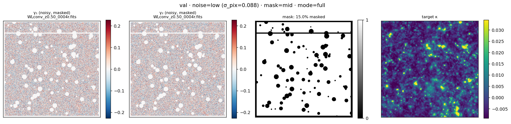

# Phase 1 Report: Dataset v1 (`dataset_v1`)

Milestone summary for the Phase 1 MassiveNuS data pipeline (`src/cosmicweb/data/`).

## Build Summary

| Property | Value |
|---|---|
| Source archive | `convergence_gal_mnv0.00000_om0.30000_As2.1000.tar` |
| Fingerprint | `aab7c9e55802405d` (`aab7c9e55802405d61cc231a5968d18fb2ff8fe7d11eaebb0630040c62fcdd51`) |
| Redshift | `z = 0.5` |
| Map geometry | `512 × 512`, `3.5° × 3.5°`, `pixel_area_arcmin2 = 0.1682` |
| Splits (by line of sight) | `7,000` train / `1,500` val / `1,500` test (`10,000` total) |
| Skipped / non-finite maps | `0` failed, `0` non-finite pixels |
| Leakage check | Passed (`0` overlapping realizations across splits, `10,000` unique `sha1` hashes) |
| Stored on Drive | `Astronova/Research/DataSet/generated_data/dataset_v1` |

## Placeholder Observation Levels (Pending Advisor Sign-Off, `#4`)

Noise and masks are generated on the fly from `dataset_v1`, so finalizing these values does not require rebuilding the stored `.npy` files.

| Noise level | `n_gal` [arcmin⁻²] | `σ_pix` |
|---|---|---|
| `low` | `30` | `0.0881` |
| `mid` | `15` | `0.1246` |
| `high` | `6` | `0.1971` |

* Mask levels: `low` (`5%`), `mid` (`15%`), `high` (`30%`).
* `σ_e = 0.28` is currently treated as total ellipticity dispersion (`σ_pix = σ_e / √(2 n_gal A_pix)`).

## Visual QA (`WLconv_z0.50_0004r.fits`, `val` split, `mask=mid`)

### Low Noise (`σ_pix = 0.088`)

### Mid Noise (`σ_pix = 0.125`)

### High Noise (`σ_pix = 0.197`)

